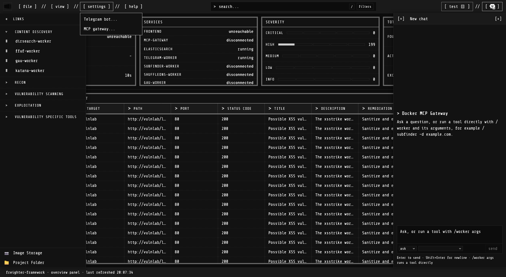

# Freighter-framework

This project is a job-runner GUI for containerized cybersecurity tools. Each tool runs in its own Docker container. The backend sends it a run request, and the browser shows the output live. Results are collected in one vulnerability ledger, searchable and filterable. This makes freighter-framework a great addition to your BugBounty or PenTesting toolkit.

The full user guide is in [MANUAL.md](MANUAL.md).



## Requirements

- Docker with a running daemon. On Windows, use Docker Desktop or Docker inside WSL2 Ubuntu. On Linux, use Docker Engine.
- Docker Compose v2, run as `docker compose`.
- GNU make, only if you want to use the Makefile.
- Git, only if you want to use the Makefile on Windows. The Makefile needs `sh`, `grep`, `tr`, and `awk`, which Git for Windows provides in `C:\Program Files\Git\usr\bin`. Add that folder to your PATH. Linux and macOS already include these tools.

Before the first build, set the image each worker should use. In `data/worker-images.env`, fill in each line:

```
SUBFINDER_TOOL_IMAGE=docker-image-publisher/docker-image-itself
```

`docker-compose.override.yml` pins some workers to one CPU architecture (`linux/arm64` or `linux/amd64`), because their images publish only that build. Compose reads it automatically, so keep it next to `docker-compose.yml`. The [MANUAL](MANUAL.md) explains it in section 2.1.

## Run with Make

From the project root:

```
make up        # check Docker and images, then build and start everything
```
```
make ps        # show service status
```
```
make logs      # follow logs
```
```
make down      # stop and remove containers (./data is kept)
```

If Docker Hub is unreachable (an outage, rate-limiting, no network), `make save-images` backs up every image this project pulls to `./data/docker-image-cache`, and `make load-images` restores them later with no registry contact. See that folder's own README.

`make help` lists every target.

Open http://localhost:3000 when it is running.

## Run manually

From the project root:

```
docker compose --env-file ./data/worker-images.env up -d --build   # build images and start everything, detached
```
```
docker compose ps              # show service status
```
```
docker compose logs -f         # follow logs
```
```
docker compose down            # stop and remove containers (./data is kept)
```

Open http://localhost:3000 when it is running.

## Services

- UI: http://localhost:3000
- Backend API: http://localhost:8080
- MCP gateway: http://localhost:8811
- Elasticsearch: http://localhost:9200

Workers publish no host ports. Only the backend and the MCP gateway can reach them.

## Data

Everything freighter-framework stores is kept under `./data`. Deleting that folder erases all profiles, files, and findings.

Shared wordlists go in `./data/wordlists`, and shared nuclei templates go in `./data/nuclei-templates`. Drop files into either folder on the host, or add them from inside the app with **[ file ] → Upload Wordlists** or **Upload Nuclei Templates**. The control panel's **Browse wordlists...** option lists `./data/wordlists`, and every tool can read it.

## Support

If freighter-framework is useful to you, you can support me by [buying me a coffee](https://buymeacoffee.com/mrl872). Top supporters will first get their hands on new versions of this project(whenever they are ready, ofc).

## Credits

Icons are from [Icons8](https://icons8.com).

## Disclaimer

THE AUTHOR IS NOT RESPONSIBLE FOR ANY MISUSE AND/OR DAMAGE CAUSED BY THE USER AND/OR THE INSTRUMENT. ONLY TEST ENVIRONMENTS YOU ARE EXPLICITLY AND LEGALLY ALLOWED TO APPROACH.
